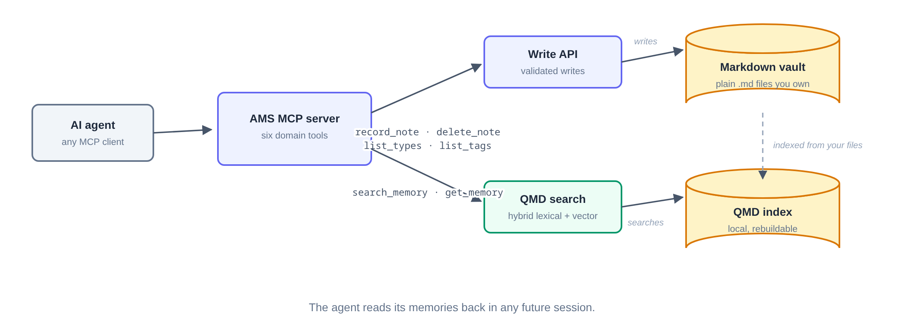
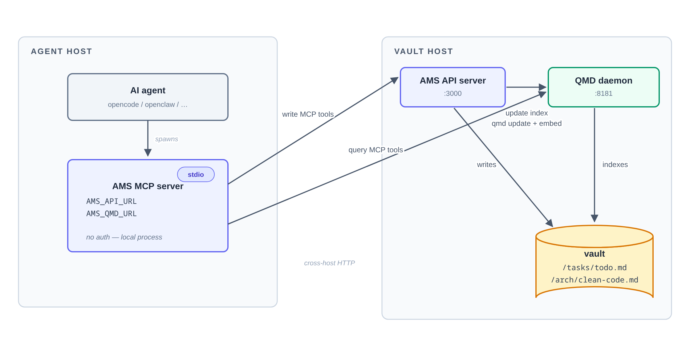
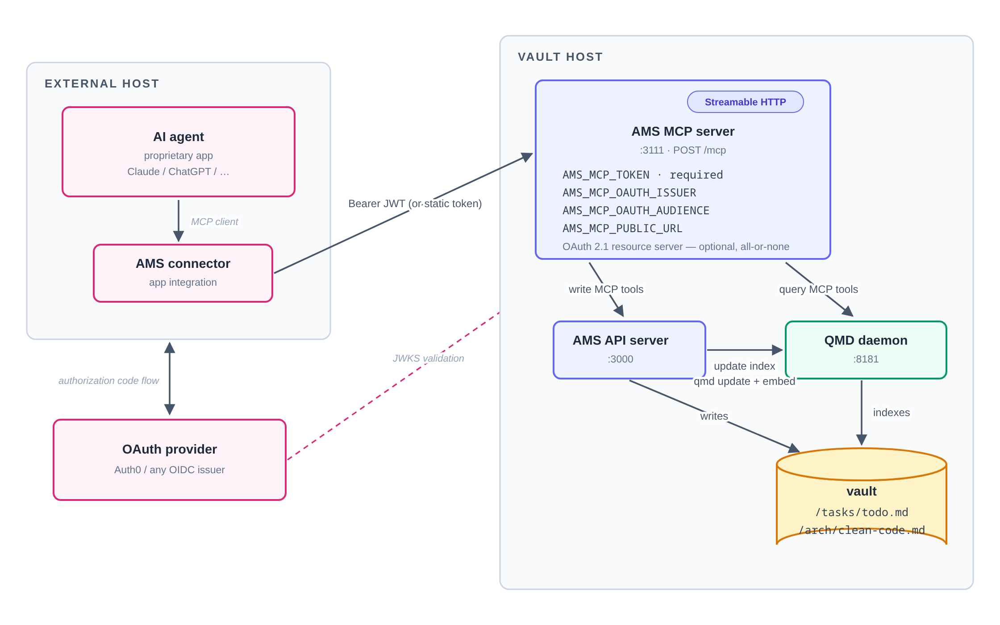

# AMS — Agents Memory System

AMS gives AI agents a durable, shared memory built on plain Markdown files.
An agent records what matters through a small set of MCP tools; every note
lands as a `.md` file in a vault **you own**; a local hybrid search index
makes those notes retrievable; and any agent — in the same session or a
future one — reads them back. Because the memory is just files, there is no
lock-in: read them with anything, back them up with anything, leave anytime
with your data in hand.



AMS is live end to end: six MCP domain tools over stdio and
Streamable HTTP, ~290 automated tests, and a CI-published Docker image.

## Quick start (Docker)

The fastest way to try AMS against a local vault is the published image,
[`ghcr.io/leandrofernandez94/ams:latest`](https://github.com/leandroFernandez94/AMS/pkgs/container/ams).
Save this as `compose.yaml` and run `docker compose up -d`:

```yaml
services:
  ams:
    image: ghcr.io/leandrofernandez94/ams:latest
    ports:
      - "3000:3000"   # Write API
      - "8181:8181"   # QMD search daemon
    volumes:
      - ams-data:/data
    restart: unless-stopped

  ams-mcp:
    image: ghcr.io/leandrofernandez94/ams:latest
    command: node packages/mcp/dist/http.js
    environment:
      AMS_MCP_TOKEN: "change-me"   # openssl rand -base64 32
      AMS_MCP_HOST: "0.0.0.0"
      AMS_API_URL: "http://ams:3000"
      AMS_QMD_URL: "http://ams:8181"
    ports:
      - "3111:3111"   # MCP Streamable HTTP
    restart: unless-stopped

volumes:
  ams-data:
```

On first boot the `ams` container creates the vault, initializes the QMD
registry and registers the vault as a collection — no manual setup. The first
indexing cycle downloads a ~300MB embedding model (one time only; it stays
cached in the `ams-data` volume).

Smoke test the loop:

```bash
curl http://localhost:3000/health        # {"status":"ok"}
```

Then point any MCP-capable client at `http://localhost:3111/mcp` with header
`Authorization: Bearer change-me` and run the loop:
`record_note` → force a reindex with
`curl -X POST http://localhost:3000/admin/reindex` (or wait ~2 minutes for
the scheduler) → `search_memory`.

### Agents on your own machine (stdio, no token)

The `ams` container does not run the stdio server — each local agent launches
it next to itself. Clone and build once, then add this to any MCP client
config:

```json
{
  "ams": {
    "command": "node",
    "args": ["/path/to/ams/packages/mcp/dist/bin.js"],
    "environment": {
      "AMS_API_URL": "http://<docker-host>:3000",
      "AMS_QMD_URL": "http://<docker-host>:8181"
    }
  }
}
```

> **Security note:** the stdio server has no authentication of any kind —
> the agent and everything it talks to run under your own responsibility.
> Use it only when the agent, the Write API and QMD run on the same host
> you control (`localhost` or local containers). For anything that crosses
> a network, use the HTTP server: bearer token on a private network, or
> OAuth for public exposure.

All installation paths (Docker, Docker + local stdio, from source) are
covered in [docs/quickstart.md](docs/quickstart.md).

## How AMS is organized

| Package | What it is |
|---|---|
| [`@ams/shared`](packages/shared) | Cross-package types and schemas — the note contract |
| [`@ams/api`](packages/api) | Write API: validated note writes, locks, embedded index scheduler |
| [`@ams/mcp`](packages/mcp) | MCP server with the six domain tools, over stdio and HTTP |

### Local stdio deployment



The MCP server runs as a child process on the agent's host — no
authentication, so this shape is only for agents and upstreams running on
the same host under your responsibility — and points `AMS_API_URL` /
`AMS_QMD_URL` at the machine hosting the vault.

### Remote HTTP deployment



The MCP server runs on the vault host as a stateless Streamable HTTP service
(`POST /mcp`) gated by a static bearer token and, optionally, an OAuth 2.1
resource-server mode (RS256/JWKS) for public exposure.

## Documentation

- [docs/architecture.md](docs/architecture.md) — components, note contract,
  authentication, configuration, caveats
- [docs/notes-processing.md](docs/notes-processing.md) — note anatomy and the
  write/update/delete lifecycle, locking, indexing
- [docs/quickstart.md](docs/quickstart.md) — installation paths (Docker,
  hybrid, from source) and first run
- [docs/e2e-runbook.md](docs/e2e-runbook.md) — end-to-end loop
  reproduction and troubleshooting
- [docs/retrieval-runbook.md](docs/retrieval-runbook.md) — QMD daemon
  operations
- [docs/deployment/](docs/deployment/) — running the stack: full Docker
  reference, remote MCP (token and OAuth 2.1)
- [openspec/specs/](openspec/specs/) — capability specifications

## Contributing

Open an issue first with your use case, the expected memory behavior, and
your constraints. Keep commits conventional; one issue per PR.

## License

MIT — see [LICENSE](LICENSE) and [CONTRIBUTING.md](CONTRIBUTING.md) for how to
contribute.
