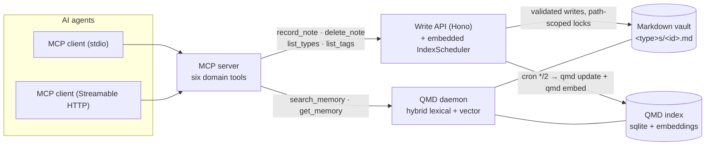

# Agents Memory System (AMS)

AMS gives AI agents a durable, shared memory built on plain Markdown. An agent
writes a note through domain tools, the note lands as a `.md` file in a vault
you own, a local hybrid search index makes it retrievable, and the agent reads
it back later — the whole loop works end to end today:

```
agent → MCP tools → Write API → Markdown vault → QMD index → agent reads back
```

## Status

The tracer-bullet milestone is **complete**: the minimal end-to-end loop
(agent → MCP → Write API → vault → QMD → agent reads back, tracked as
GitHub issues `Spec 1`..`Spec 7`) is implemented and verified.

- Six MCP domain tools: `record_note`, `delete_note`, `list_types`,
  `list_tags`, `search_memory`, `get_memory`.
- Two transports: stdio (every MCP client) and Streamable HTTP with static
  bearer auth plus an optional OAuth 2.1 resource server (RS256/JWKS,
  RFC 9728 metadata).
- ~280 automated test cases across 25 files (`pnpm test`, plus the end-to-end
  suite via `pnpm tracer`).
- CI runs lint, typecheck and tests (Node 22), scans for secrets, and
  publishes a Docker image to ghcr.io.

## How it works



- **Writes** go through MCP domain tools → the Write API, which validates
  input, derives a slug path (`<type>s/<id>.md`), takes a path-scoped lock,
  and writes the note. An embedded scheduler reindexes the vault every two
  minutes by shelling out to the `qmd` CLI.
- **Reads** go through `search_memory` / `get_memory` → a QMD daemon (hybrid
  lexical + vector search, RRF fusion) that indexes the same vault. AMS never
  builds its own retrieval index — see the
  [Retrieval Runbook](./docs/retrieval-runbook.md).

### Packages

| Package | What it is |
|---|---|
| [`@ams/shared`](./packages/shared) | Cross-package types and schemas — the type-generic note contract |
| [`@ams/api`](./packages/api) | Write API (Hono): validated note writes, path-scoped locks, embedded index scheduler |
| [`@ams/mcp`](./packages/mcp) | MCP server with the six domain tools, over stdio (`ams-mcp`) and Streamable HTTP (`ams-mcp-http`) |

## Quick start

1. Install QMD ≥ 2.5.3: `npm i -g @tobilu/qmd`
2. Clone and build: `pnpm install && pnpm build`
3. Create a vault and register it with QMD (`qmd init`,
   `qmd collection add <vault> --name ams`)
4. Start the QMD daemon (`qmd mcp --http`) and the Write API
   (`AMS_VAULT_PATH=<vault> node packages/api/dist/server.js`)
5. Connect an MCP client (stdio or HTTP) and run the loop:
   `record_note` → reindex → `search_memory` → `get_memory`
6. Verify with the e2e suite: `pnpm tracer`

Full walkthrough with client configuration snippets:
[docs/quickstart.md](./docs/quickstart.md).

## Core design principles

- **Markdown-first durability**: data remains usable without a proprietary
  backend.
- **Read/Write separation**: retrieval and persistence are independent
  concerns.
- **Semantic writes**: agents call domain tools (`record_note`), not raw file
  writes.
- **Conflict safety**: prefer append-only operations; use structured upserts
  (`topic_key`) for canonical notes.

## Security and portability

This repository is public. All examples and code must follow these
constraints:

- no secrets or credentials in git history
- no host-specific absolute paths (for example `/home/<user>/...`)
- no assumptions about a single machine layout
- all runtime configuration via environment variables

See [SECURITY.md](./SECURITY.md) for disclosure and contributor rules.

## Documentation

- [docs/README.md](./docs/README.md) — index of all guides
- [docs/architecture.md](./docs/architecture.md) — components, write/read
  paths, authentication, operational caveats
- [docs/quickstart.md](./docs/quickstart.md) — clone → working loop
- [docs/tracer-runbook.md](./docs/tracer-runbook.md) — end-to-end loop
  reproduction and troubleshooting
- [docs/retrieval-runbook.md](./docs/retrieval-runbook.md) — QMD daemon
  operations
- [docs/remote-mcp-deployment.md](./docs/remote-mcp-deployment.md) — remote
  MCP topologies, Streamable HTTP and public OAuth deployment
- [openspec/specs/](./openspec/specs/) — capability specifications
  ([mcp-domain-tools](./openspec/specs/mcp-domain-tools/spec.md),
  [e2e-tracer-suite](./openspec/specs/e2e-tracer-suite/spec.md))

## Contributing

Open an issue first with your use case, the expected memory behavior, and
your constraints (scale, latency, security). Keep commits conventional;
one issue per PR.

## License

MIT (see the `license` field in [package.json](./package.json)).
