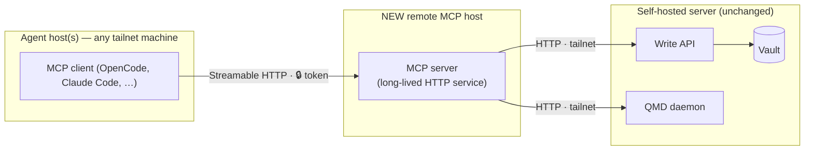
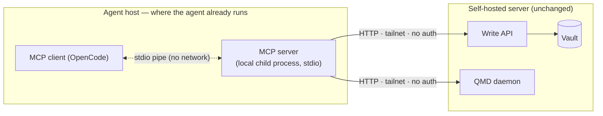
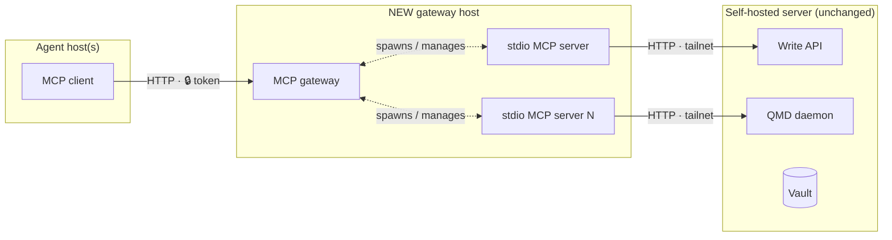
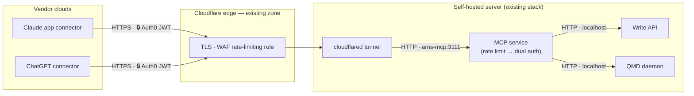

# Remote MCP Deployment — Investigation (#27)

Status: DECIDED — revised 2026-10-03 after review: topology 1 is the target
(phased). Phase 1 (#37) is implemented on `feat/mcp-streamable-http` and
phase 2 (#39) on `feat/mcp-public-oauth` — neither is merged or deployed
yet. See [Recommendation](#recommendation), the
[Phase 1 runbook](#phase-1-runbook-streamable-http) and the
[Phase 2 runbook](#phase-2-runbook-public-oauth-exposure).
Date: 2026-10-03 · phase 2 runbook added 2026-10-17

## Context

The MCP server (`packages/mcp`) is stdio-only: `bin.ts` wires `createServer()`
into a `StdioServerTransport` and the process runs wherever the MCP client
runs. Tools reach the Write API and the QMD daemon over plain HTTP via
`globalThis.fetch`, using `AMS_API_URL` (required, no default) and
`AMS_QMD_URL` (defaults to `http://localhost:8181`). Configuration is resolved
lazily so the server starts even when an upstream is down; tools degrade
per-call.

Hard constraint (from #27): the vault, Write API and QMD daemon stay on the
current self-hosted server. A remote MCP deployment would reach those
upstreams over the tailnet.

### Verified current deployment

The primary client (OpenCode on the dev server) already runs the topology
labelled "topology 2" below:

```json
"ams": {
  "command": ["node", "/home/leandro/projects/AMS/packages/mcp/dist/bin.js"],
  "environment": {
    "AMS_API_URL": "http://100.64.20.67:3050",
    "AMS_QMD_URL": "http://100.64.20.67:8182"
  }
}
```

`100.64.x.x` is Tailscale's CGNAT range — both upstreams are reached over the
tailnet today, and the MCP process runs on the agent host. This is not a
hypothetical topology; it is the running baseline.

Architectural fact that shapes everything below: `createServer()` is
transport-agnostic (transport wiring lives entirely in the 15-line `bin.ts`),
and the MCP server holds no session state — every tool call is a stateless
HTTP round-trip to an upstream. Adding a second transport is additive, not
structural.

## Evidence

### SDK support (official TypeScript SDK)

- **Streamable HTTP** is the current standard network transport. The SDK ships
  `StreamableHTTPServerTransport` with two modes:
  - *Stateless*: `sessionIdGenerator: undefined` — each POST is handled
    independently, no session map, trivially horizontal. Fits AMS perfectly
    because tools are already stateless.
  - *Stateful*: `sessionIdGenerator: () => randomUUID()` — session map keyed
    by the `Mcp-Session-Id` header, idle eviction, GET stream for server
    notifications. AMS gains nothing from this today (no server-initiated
    messages, no subscriptions).
- **HTTP+SSE is deprecated** (remains as a client-side fallback only). Any new
  server-side work should target Streamable HTTP.
- **Auth**: the SDK's `requireBearerAuth` middleware gates a route behind a
  bearer token (401 `invalid_token` / 403 `insufficient_scope` with proper
  `WWW-Authenticate` challenges). Full OAuth 2.1 resource-server behaviour
  (RFC 9728 metadata routes, discovery) is available but only pays off with
  real authorization servers and multiple users.

> **Auth revision (2026-10-03, user-approved).** Phase 1 ships Hono's
> `bearer-auth` middleware, not the SDK's `requireBearerAuth`. Evidence
> (verified against installed sources): `requireBearerAuth` is Express-typed
> middleware (`RequestHandler` from `express`, which is not a workspace
> dependency) and rejects tokens that lack a numeric future `expiresAt` —
> designed for OAuth flows, awkward for a static token. Hono 4.12.27 was
> already in the dependency graph (`packages/api`); its `bearerAuth` compares
> timing-safely and emits proper `WWW-Authenticate` challenges, and the SDK's
> own docs show the Hono integration for the web-standard transport
> (`transport.handleRequest(c.req.raw)`). Phase 2 (#39) still plans the
> SDK's OAuth 2.1 resource-server machinery — only the phase 1 static-token
> mechanism is revised. (Superseded 2026-10-17: phase 2 ships a Hono +
> `jose` resource server instead of the SDK auth routers — see the
> [Phase 2 runbook](#phase-2-runbook-public-oauth-exposure).)

### Client support

- **OpenCode** (primary client): first-class remote MCP — `"type": "remote"`
  with `url`, custom `headers` (e.g. `Authorization: Bearer {env:TOKEN}`) and
  optional OAuth blocks. It constructs a StreamableHTTP client transport with
  an SSE legacy fallback automatically.
- **Claude Code / Codex / mainstream clients**: support streamable HTTP MCP
  endpoints (`claude mcp add --transport http`, `url`-based server entries).
  Support is broad but not literally universal; long-tail and older clients
  still assume stdio.
- **stdio**: supported by every MCP client without exception. It remains the
  compatibility baseline.

### Deployment surface

- The ghcr.io image (#18) already builds `packages/mcp` (Dockerfile compiles
  shared + api + mcp), so a remote host can pull one image and run either an
  upstream or an MCP process — the HTTP entrypoint
  (`packages/mcp/dist/http.js`, #37) now ships in the image, no Dockerfile
  change needed.

## Topologies evaluated

All three topologies are answers to one question: **where does the MCP
process run, and what stands between the agent and the vault?** The vault
box (Write API, QMD daemon, vault) is identical and never moves — only the
left side changes.

Legend: `─▶` network hop (needs the tailnet up) · `◁▷` local pipe/process
boundary (no network) · 🔒 point where a token/auth is required.

### Topology 1 — Network-facing MCP (Streamable HTTP) on a remote host

The MCP server becomes a long-lived HTTP service on the tailnet; agents
connect with a URL (+ token) instead of spawning a local process.



Two network legs per call (agent → MCP host, MCP host → upstreams). The MCP
process is shared by every agent, so it must authenticate callers and stay
up for everyone.

- **Pros**: one MCP deployment shared by all agent hosts; no Node/runtime
  requirement on agent hosts; client config shrinks to a URL; server-side
  observability (logs, health endpoint) in one place.
- **Cons**: requires auth on the MCP service itself (new secret, new
  rotation); session/lifecycle management even in stateless mode (health
  checks, restarts, idle behavior); adds a network hop between agent and
  upstreams (agent → MCP host → tailnet → API/QMD) which increases failure
  modes exactly where the issue worries about tailnet outages; every client
  must support HTTP transports (nearly true, not universally true).

### Topology 2 — stdio MCP on the agent host, upstreams over the tailnet (CURRENT)

The MCP process runs wherever the agent runs; `AMS_API_URL`/`AMS_QMD_URL`
point at tailnet addresses of the self-hosted server.



One network leg per call. The MCP process is not network-facing at all — it
is spawned by the agent and talks to its client over a local pipe — so the
tailnet is the only boundary and no token exists to leak or rotate.

- **Pros**: zero code changes (this is today's `bin.ts`); zero auth surface on
  the MCP side (the tailnet is the boundary — traffic never leaves the
  private network); one fewer network hop; stdio compatibility everywhere;
  per-agent isolation (one hung MCP process cannot affect other agents).
- **Cons**: every agent host needs the MCP artifact (checkout build or image
  pull) plus per-host env config; one process per agent session; upgrading the
  MCP means touching every agent host.

### Topology 3 — MCP gateway/proxy in front of stdio servers

A gateway accepts network MCP connections and fans out to N stdio server
processes.



Same two network legs as topology 1 plus a translation layer: the gateway
converts network MCP into local stdio processes. It exists to serve *many*
servers behind one endpoint — with exactly one server, it is a second
component to operate with nothing to fan out to.

- **Pros**: centralizes transport, auth and versioning for many servers;
  stdio servers stay untouched.
- **Cons**: a whole new component to operate for a fleet of exactly one
  server and one user; the gateway becomes a single point of failure that
  topology 2 does not have. Rejected as over-engineering at current scale.

## Comparison

| Dimension             | 1: Streamable HTTP | 2: stdio + tailnet (current) | 3: Gateway |
| --------------------- | ------------------ | ---------------------------- | ---------- |
| Code changes          | Add transport+auth | None                         | New service |
| Auth surface          | Token required     | Tailnet boundary only        | Token required |
| Network hops          | +1 (via MCP host)  | Direct                       | +1 |
| Client compatibility  | Broad, not total   | Universal                    | Broad, not total |
| Ops burden            | Service to run     | Artifact per agent host      | Service + fleet |
| Failure isolation     | Shared service     | Per agent process            | Shared gateway |

## Security model

For a single-user deployment, phased:

- **Phase 1 (tailnet-only service)**: tailnet reachability is the primary
  boundary; the static bearer token is defense in depth (a compromised
  tailnet peer or a misconfigured funnel must not get free write access to
  the memory vault). The MCP listens on the tailnet interface only.
- **Phase 2 (public exposure)**: the bar rises. The token alone is NOT an
  acceptable boundary between the public internet and vault writes — it must
  be OAuth 2.1 (the SDK's resource-server machinery with RFC 9728 metadata)
  or tunnel-fronted Cloudflare Access in front of the route, plus HTTPS via
  the existing cloudflared tunnel. *(Resolved 2026-10-17: OAuth 2.1 with
  Auth0, implemented with Hono + `jose`; Cloudflare Access rejected on
  vendor evidence — see the
  [Phase 2 runbook](#phase-2-runbook-public-oauth-exposure).)*
- Upstream traffic (MCP → API/QMD) stays plain HTTP *inside* the tailnet;
  WireGuard encryption covers the transport. No TLS work needed for upstream
  legs even in phase 2 — only the public MCP edge needs HTTPS.

## Operational concerns (apply to any remote variant)

- **Image**: remote host pulls from ghcr.io (#18); image already contains the
  compiled `packages/mcp`.
- **Config**: env-based as today (`AMS_API_URL`, `AMS_QMD_URL`); resolved
  lazily, so an unreachable upstream degrades per tool call — the server must
  keep starting and answer with tool-level errors, never crash at boot.
- **Failure modes**: tailnet link down → fetch timeouts per call; API down →
  write tools fail, read tools (QMD) may still work; QMD down → inverse.
  Health checks should probe the upstreams, not just the process.
- **Upgrades**: topology 2 upgrades are per-agent-host (pull + restart agent);
  topology 1 upgrades are one service restart shared by everyone.

## Recommendation

> **Revised after review.** The original recommendation kept stdio as the
> baseline. Two review considerations outweigh the minimal-surface argument:

### Why topology 1 wins on review

1. **Deployment centralization.** With stdio, every MCP change means pulling
   and deploying the artifact on every agent host (N hosts). With a
   network-facing MCP, one image update reaches every client on its next
   `initialize` — clients never need to be touched.
2. **Clients on hosts we do not control.** Mobile/web apps (Claude app
   custom connectors, ChatGPT connectors) speak remote MCP over HTTPS; they
   cannot spawn local stdio processes at all. Topology 2 makes these clients
   unreachable by construction; topology 1 unlocks them.

The trade is explicit: we accept one more network leg and a token to manage
in exchange for centralized deploys and client portability.

### Phased plan

**The MCP service does not need new hardware — it deploys on the existing
self-hosted server** (one more service in the compose stack, image from
ghcr.io). This is strictly better than a separate MCP host: MCP → upstream
calls become localhost/container-network round-trips (the tailnet-link
failure mode between MCP and upstreams disappears), and there is one box to
operate. The original "separate host" framing in #27 is satisfied by a
separate *service*, not a separate machine.

- **Phase 1 — tailnet service (#37)**: MCP as a long-lived HTTP service on
  the existing server, reachable at its tailnet address. Stateless Streamable
  HTTP behind a static bearer token (Hono `bearerAuth` — see the
  [auth revision](#sdk-support-official-typescript-sdk)), upstreams at
  localhost. Own agents (OpenCode on any tailnet host) switch from local
  stdio to the remote URL. Deployment becomes one image update; no public
  exposure. **Status: implemented on `feat/mcp-streamable-http` — see #37
  and the [Phase 1 runbook](#phase-1-runbook-streamable-http).**
- **Phase 2 — public reachability for external apps (#39)**: Claude app /
  ChatGPT clients run on vendor clouds and cannot reach a tailnet-only
  service. The existing cloudflared tunnel on the same server fronts the MCP
  with public HTTPS (origin at localhost) AND a real auth upgrade (OAuth 2.1
  resource server, or tunnel-fronted Cloudflare Access) — a static token
  alone is not an acceptable boundary between the public internet and write
  access to the vault. **Status: implemented on `feat/mcp-public-oauth` —
  see #39 and the
  [Phase 2 runbook](#phase-2-runbook-public-oauth-exposure).**

Topology 2 remains the running baseline until the phases merge and deploy:
phase 1 (#37) is implemented on `feat/mcp-streamable-http` and phase 2 (#39)
on `feat/mcp-public-oauth` — see the runbooks below. Topology 3 stays
rejected (one server, one user — nothing to fan out).

### Decision summary

| Question     | Answer                                                  |
| ------------ | ------------------------------------------------------- |
| Transport    | Stateless Streamable HTTP (target); stdio stays as migration fallback |
| Auth         | Phase 1: static bearer token, tailnet-only. Phase 2: OAuth 2.1 / tunnel-fronted access for public |
| Network      | MCP runs on the existing self-hosted server: own agents reach it via tailnet (phase 1), external apps via cloudflared public HTTPS (phase 2). Upstreams stay localhost. Vault/API/QMD never move |

## Phase 1 runbook (Streamable HTTP)

Implemented on `feat/mcp-streamable-http` (see #37); not yet merged or
deployed. The stdio path is byte-for-byte unchanged and remains the
local/fallback transport.

### Quick path (local)

1. Generate a token (see the charset note below):

   ```bash
   openssl rand -base64 32
   ```

2. Build and start the service — both forms are equivalent:

   ```bash
   pnpm build

   # direct node invocation
   AMS_MCP_TOKEN="<token>" AMS_API_URL=http://localhost:3000 \
     node packages/mcp/dist/http.js

   # or via the package bin (linked by pnpm on install)
   AMS_MCP_TOKEN="<token>" AMS_API_URL=http://localhost:3000 pnpm exec ams-mcp-http
   ```

3. Verify:

   ```bash
   curl -s http://127.0.0.1:3111/health
   # {"status":"ok","upstreams":{"api":"up","qmd":"up"}}

   curl -i -X POST http://127.0.0.1:3111/mcp
   # HTTP/1.1 401 Unauthorized + WWW-Authenticate: Bearer realm=""
   ```

Point a remote-capable client at `http://<host>:3111/mcp` with an
`Authorization: Bearer <token>` header.

### Configuration

| Variable | Required | Default | Purpose |
| --- | --- | --- | --- |
| `AMS_MCP_TOKEN` | Yes (HTTP mode) | — | Static bearer token for `POST /mcp`. Startup fails fast when missing or empty; stdio mode ignores it. |
| `AMS_MCP_PORT` | No | `3111` | TCP port for the HTTP listener. Must be a non-negative number (validated at startup). |
| `AMS_MCP_HOST` | No | `127.0.0.1` | Bind address. Loopback by default; set `0.0.0.0` inside a container and let the port mapping control exposure. |
| `AMS_API_URL` | Yes | — | Write API base URL (no trailing slash). Used by the tools and the `/health` probe. |
| `AMS_QMD_URL` | No | `http://localhost:8181` | QMD base URL. Used by the tools and the `/health` probe. |

> **Token charset.** Hono's `bearer-auth` validates the token value in the
> `Authorization` header against `[A-Za-z0-9._~+/-]+=*` (verified in
> hono@4.12.27). A token containing any other character (embedded `=`, `:`,
> spaces, …) gets a `400` on every request. `openssl rand -base64 32`
> output qualifies.

### Endpoints

| Method & path | Auth | Behavior |
| --- | --- | --- |
| `POST /mcp` | Bearer token | MCP endpoint. Stateless: a fresh server + transport per request, JSON responses (`enableJsonResponse`), no sessions, no server-initiated SSE. |
| Other methods on `/mcp` | Bearer token | `405` with `Allow: POST` (a missing or bad token still yields `401` — auth runs before method routing). |
| `GET /health` | None | Upstream probe: `200` when both upstreams are `up`, `503` otherwise. Probes run in parallel with a 2s timeout each. |

Auth failures (Hono `bearerAuth`):

- missing `Authorization` header → `401`, `WWW-Authenticate: Bearer realm=""`
- valid charset, wrong value → `401`, `WWW-Authenticate: Bearer error="invalid_token"`
  (timing-safe comparison)
- malformed token (charset) → `400`, `WWW-Authenticate: Bearer error="invalid_request"`

`GET /health` response shapes:

```json
// 200 — both upstreams reachable
{ "status": "ok", "upstreams": { "api": "up", "qmd": "up" } }

// 503 — at least one upstream not up
{ "status": "degraded", "upstreams": { "api": "up", "qmd": "down" } }
```

Per-upstream values: `up` (probe returned 2xx), `down` (failure, non-2xx, or
timeout), `unconfigured` (empty base URL — counts as not ok). The endpoint
reports reachability only, never note content.

### Process behavior

- Logs to stderr only (`[ams-mcp-http] listening on ...`); stdout stays clean.
- `SIGTERM`/`SIGINT` → graceful close (idle keep-alive sockets drained) then
  exit 0 — `docker stop` terminates cleanly.
- Listener errors (e.g. `EADDRINUSE`) → fatal stderr line, exit 1.
- Missing `AMS_MCP_TOKEN` → startup fails fast: the entrypoint refuses to
  serve unauthenticated.
- Starts with upstreams down: configuration is lazy, tools degrade per call,
  `/health` reports `down`, the process stays up.

### Compose service (self-hosted stack)

The ghcr.io image already ships `packages/mcp/dist` and its production
dependencies, so no Dockerfile change is needed — the service only overrides
the command. Overriding `command` replaces the image's boot sequence, so this
container runs *only* the MCP service; the upstreams are the existing stack
services reached over the container network:

```yaml
services:
  ams-mcp:
    image: ghcr.io/leandrofernandez94/ams:latest
    command: node packages/mcp/dist/http.js
    environment:
      AMS_MCP_TOKEN: "${AMS_MCP_TOKEN:?set in .env}" # openssl rand -base64 32
      AMS_MCP_HOST: "0.0.0.0" # bind-all inside the container
      AMS_API_URL: "http://ams:3000" # existing Write API service (adjust name)
      AMS_QMD_URL: "http://ams:8181" # existing QMD daemon (adjust name)
    ports:
      - "100.64.20.67:3111:3111" # publish on the tailnet interface ONLY
    healthcheck:
      # the image's built-in HEALTHCHECK probes the Write API, not this
      # service — this service needs its own stanza
      test: ["CMD", "wget", "-q", "-T", "4", "-t", "1", "-O", "/dev/null", "http://localhost:3111/health"]
      interval: 30s
      timeout: 5s
      start_period: 20s
      retries: 3
    restart: unless-stopped
```

Notes:

- `wget` is available in the image (installed in the runtime stage) and
  treats the `503` degraded response as failure — an unreachable upstream
  marks the container unhealthy while the process keeps running. Treat
  unhealthy as "investigate upstreams", not "restart the service".
- The port mapping publishes on the host's tailnet address
  (`100.64.20.67` here — adjust to your host); nothing listens on the LAN or
  public interfaces.

> **Tailnet-only in phase 1.** The static token is defense in depth (see
> [Security model](#security-model)) — the tailnet is the boundary. Do NOT
> publish `AMS_MCP_PORT` on a public interface or through a public tunnel.
> Public exposure is phase 2 (#39), now implemented — follow the
> [Phase 2 runbook](#phase-2-runbook-public-oauth-exposure) (OAuth 2.1;
> Cloudflare Access was rejected on vendor evidence).

## Phase 2 runbook (public OAuth exposure)

Implemented on `feat/mcp-public-oauth` (see #39); not yet merged or deployed.
This runbook turns the phase-1 tailnet service into a publicly reachable
OAuth 2.1 resource server for vendor-cloud clients (Claude app custom
connectors, ChatGPT connectors). Phase 1 is untouched: with the OAuth
variables unset, the service behaves exactly as documented above.

What phase 2 adds, in one paragraph: Auth0 becomes the authorization server
(decision 2 — external account in exchange for not owning token-issuance
code); `POST /mcp` accepts Auth0-issued RS256 JWTs next to the static token
(dual credentials, decision 4), validated with `jose`; RFC 9728
protected-resource metadata is served for client discovery; and an in-app
rate limiter on `/mcp` bounds floods before any auth work runs (decision 7).
Cloudflare Access was rejected on evidence (decision 1): vendor-cloud
connector clients attach OAuth bearer tokens ONLY — they cannot complete an
interactive Access login nor attach Access service-token headers.

Everything below except the service configuration is ops work outside this
repository (decision 8): Cloudflare dashboard, Auth0 dashboard, vendor apps.
External claims are attributed inline with their source and retrieval date;
consolidated in [References](#references).

### Public path architecture



Legend: 🔒 point where a credential is required. Two client populations
share one service:

| Population | Path | Credential |
| --- | --- | --- |
| Own agents (OpenCode, phase 1) | `http://100.64.20.67:3111/mcp` (tailnet, direct) | Static bearer token |
| Public connectors (phase 2) | `https://mcp.example.com/mcp` (edge → tunnel) | Auth0-issued JWT (RS256) |

The upstream legs do not change: MCP → Write API / QMD stays plain HTTP on
localhost / the container network. Only the public MCP edge needs HTTPS, and
the existing tunnel provides it.

### Service configuration

New environment variables, read by the shared config resolver and enforced
by the HTTP entrypoint (matching `packages/mcp/src/config.ts` exactly):

| Variable | Required | Default | Validation | Purpose |
| --- | --- | --- | --- | --- |
| `AMS_MCP_OAUTH_ISSUER` | With the OAuth triple | — (unset = phase 1) | `https` URL, no query or fragment; trailing slash ALLOWED | Auth0 issuer URL, kept **verbatim**: `jose` compares the JWT `iss` claim literally, so this must equal the issuer exactly as tokens carry it (Auth0 issuers conventionally include the trailing slash, e.g. `https://<tenant>.auth0.com/`). |
| `AMS_MCP_OAUTH_AUDIENCE` | With the OAuth triple | — | Any non-empty string (not required to be a URL) | Matched literally against the JWT `aud` claim. Set it to the Auth0 API **Identifier** (recommended: `https://mcp.example.com/mcp` — see [Auth0 setup](#auth0-setup)). |
| `AMS_MCP_PUBLIC_URL` | With the OAuth triple | — | `https` URL, no query or fragment, **no trailing slash** | Public base URL of this service. Becomes the RFC 9728 `resource` value (`<publicUrl>/mcp`) and the base of the `resource_metadata` URL in 401 challenges. |
| `AMS_MCP_RATE_LIMIT` | No | `120` | Non-negative integer; `0` disables the limiter | Max requests per minute per client key on `POST /mcp`. Key = `CF-Connecting-IP`, falling back to the socket address. |

> **All-or-none triple.** Setting only one or two of the three OAuth
> variables is a startup `ConfigError` (`must be set together (found N of
> 3)`) — a half-configured resource server would silently reject every JWT.
> All three unset keeps phase-1 behavior. A whitespace-only
> `AMS_MCP_RATE_LIMIT` trims to empty and falls back to the default (fails
> safe, not open).

Additions to the phase-1 compose service:

```yaml
environment:
  AMS_MCP_TOKEN: "${AMS_MCP_TOKEN:?set in .env}"  # still required (phase 1 path)
  AMS_MCP_OAUTH_ISSUER: "https://<tenant>.auth0.com/"    # verbatim, as iss appears
  AMS_MCP_OAUTH_AUDIENCE: "https://mcp.example.com/mcp"  # Auth0 API identifier
  AMS_MCP_PUBLIC_URL: "https://mcp.example.com"          # no trailing slash
  AMS_MCP_RATE_LIMIT: "120"                              # 0 disables the limiter
```

Endpoint deltas when the triple is set:

| Method & path | Auth | Behavior |
| --- | --- | --- |
| `GET /.well-known/oauth-protected-resource/mcp` | None | RFC 9728 protected-resource metadata: `{ "resource": "<publicUrl>/mcp", "authorization_servers": ["<issuer>"], "scopes_supported": null }`. Mounted only in OAuth mode — discovery must work before any token exists. `scopes_supported` is null: no scope enforcement in v1 (single user; audience-only authorization, documented). |
| `POST /mcp` (rate limit) | — | `429 Too Many Requests` + `Retry-After` (1–60 s, seconds until the minute window resets) when a client key exceeds the limit. Counted before auth: unauthenticated floods are throttled without any JWT/JWKS work. |
| `POST /mcp` (auth) | Static token **or** JWT | Static token checked first (timing-safe, no network). Anything else is treated as an Auth0 JWT: `jose jwtVerify` with RS256 pinned, literal `iss` + `aud`, required `exp`, 30 s clock tolerance. Every failure mode (bad signature, unknown key, expired, wrong iss/aud, JWKS fetch error) collapses to one `401 invalid_token` challenge. |

In OAuth mode every 401/400 challenge carries the RFC 9728
`resource_metadata` hint so connector clients can discover the authorization
server. `/health` and the metadata route stay unlimited: health checks must
answer reliably (Docker) and the metadata document is static JSON.

### Auth0 setup

Once per Auth0 tenant. Dashboard paths verified against the Auth0 docs
(retrieved 2026-10-17).

1. **Create the API** — Dashboard > Applications > APIs > **+ Create API**:

   - **Name**: `AMS MCP` (display only).
   - **Identifier**: `https://mcp.example.com/mcp`. Auth0 recommends a URL
     and it never needs to be publicly reachable — but it must equal what
     the connectors send as the RFC 8707 `resource` parameter, which is the
     RFC 9728 `resource` value AMS publishes (`<publicUrl>/mcp`). The
     identifier cannot be modified afterwards. AMS itself accepts any
     non-empty audience string; using the `/mcp` URL is what makes the
     connector flows line up end to end.
   - **Signing algorithm**: `RS256` (AMS pins RS256; the token is signed
     with the tenant's private key).

2. **Enable the MCP-relevant tenant toggles** — Settings > Advanced:

   - **Resource Parameter Compatibility Profile**: Auth0 accepts the
     `resource` parameter on `/authorize` and stamps it into the token's
     audience (when both `resource` and `audience` are present, `audience`
     wins). Both clients follow the MCP authorization specification, which
     sends the RFC 8707 `resource` parameter (documented explicitly for
     ChatGPT; Claude follows the same MCP authorization specs), so this
     toggle routes those requests to the AMS API.
   - **Include Issuer in Authorization Responses**: returns `iss` on every
     authorization response (RFC 9207 mix-up protection). OpenAI uses this
     to qualify an authorization server for ChatGPT's stable redirect URI.

3. **Create one Application per connector** — Dashboard > Applications >
   Applications > **Create Application** > **Create it manually** >
   **Regular Web Applications** (the connector runs server-side on the
   vendor cloud and can hold a client secret). Suggested names:
   `AMS MCP — Claude`, `AMS MCP — ChatGPT`. One Application per connector
   keeps credentials independently rotatable and auditable.

4. **Allowed Callback URLs** — set per application (`callbacks`), exactly
   these values:

   | Application | Callback URL(s) | Source (retrieved 2026-10-17) |
   | --- | --- | --- |
   | `AMS MCP — Claude` | `https://claude.ai/api/mcp/auth_callback` | Anthropic docs |
   | `AMS MCP — Claude` (only if you also connect Claude Code) | `http://localhost/callback` and `http://127.0.0.1/callback`, matched port-agnostically | Anthropic docs |
   | `AMS MCP — ChatGPT` | `https://chatgpt.com/connector_platform_oauth_redirect` (stable) and/or the callback-ID form `https://chatgpt.com/connector/oauth/{callback_id}` shown on the connector's management page | OpenAI docs |
   | Testing (optional) | `http://localhost:6274/oauth/callback` (MCP Inspector) | Auth0 docs |

   Which ChatGPT redirect applies depends on whether the authorization
   server meets OpenAI's RFC 9207 issuer-identification requirements (the
   step-2 toggle exists to qualify). When in doubt, copy the exact redirect
   URI the connector shows at setup and paste it into the allowlist.

5. **PKCE**: both clients send an S256 `code_challenge` on every
   authorization request and require the server to support it. This rides
   Auth0's authorization-code flow — there is no per-application PKCE
   switch to configure.

6. **Access-token lifetime** — API > Settings > **Maximum Access Token
   Lifetime (Seconds)**: default 86400 (24 h), maximum 2592000 (30 days).
   Both clients refresh access tokens (Claude proactively before expiry and
   reactively on 401; OpenAI's contract refreshes and rotates tokens), so
   the default works — for a vault-write API consider lowering it (e.g.
   3600). Enable **Allow Offline Access** on the API so applications can
   request refresh tokens. AMS independently requires every accepted token
   to carry `exp`.

7. **Client registration model.** This runbook uses manual registration:
   one Application per connector, created above. Correction to an earlier
   assumption from the #39 exploration: Auth0 does now offer Dynamic Client
   Registration (RFC 7591) — disabled by default (Settings > Advanced
   toggle), every DCR-created application is a third-party application, and
   Auth0 itself recommends manual (CIMD) registration for production MCP
   deployments because an open `/register` endpoint invites abuse. Manual
   registration needs no tenant changes and no open registration endpoint,
   which is why it is the documented path here.

> **Discovery endpoint note.** Both clients accept either RFC 8414
> (`/.well-known/oauth-authorization-server`) or OpenID Connect discovery
> (`/.well-known/openid-configuration`) from the authorization server.
> Whether Auth0 serves the RFC 8414 document at the tenant root is
> UNVERIFIED as of 2026-10-17; the OIDC discovery document is the
> universally available alternative both vendors accept.

### Connector setup

#### Claude app (custom connector)

Verified against Anthropic's docs (retrieved 2026-10-17). Connections
originate from Anthropic's cloud infrastructure, not your device — your
server must be reachable from the public internet:

1. **Customize > Connectors > "+ Add" → "Add custom connector"**
   (Team/Enterprise: an Owner first adds it under Organization settings >
   Connectors > Add > Custom > Web).
2. Name the connector, enter the MCP server URL
   `https://mcp.example.com/mcp`, continue.
3. Review the authentication settings Claude detected; adjust if your
   server needs something different.
4. Under **Authentication** choose **Sign in now** (OAuth; "Sign in when
   needed" and "No sign in" are the alternatives).
5. Under **OAuth client** choose **Use your own OAuth client** and enter the
   Client ID and Client Secret of the `AMS MCP — Claude` application (the
   secret is optional in the dialog; a Regular Web Application needs it).
   The other options — Claude's published identity (CIMD) and "Register
   automatically" (DCR) — exist, but the manual client matches the Auth0
   setup above.
6. Finish with **Add**, connect, and consent. Claude sends S256 PKCE on
   every authorization request and refreshes tokens automatically.

#### ChatGPT (developer connector)

The OAuth contract is verified (retrieved 2026-10-17); the exact dashboard
labels for the connector builder are UNVERIFIED — prefer what the
connector's management page shows:

1. Create a developer connector in the ChatGPT connector/app builder with
   the MCP server URL `https://mcp.example.com/mcp`.
2. Configure OAuth with a predefined client: enter the Client ID and Client
   Secret of the `AMS MCP — ChatGPT` application. (ChatGPT also supports
   CIMD — its preferred method — and DCR for client identity; the predefined
   client is the manual path that matches the Auth0 setup above.)
3. Copy the redirect URI the management page displays into that
   application's Allowed Callback URLs (see the Auth0 table).
4. Connect and consent. ChatGPT runs the authorization-code + PKCE flow
   against the Auth0 discovery metadata it finds through the RFC 9728
   document AMS serves.

#### Compatibility matrix (evidence, retrieved 2026-10-17)

| Client | Supported auth modes | OAuth client identity | Redirect / callback URL | Source |
| --- | --- | --- | --- | --- |
| Claude app (claude.ai, Desktop, mobile, Cowork) | OAuth 2.0; static credential request header (beta, limited orgs); no auth | DCR (default), CIMD, Anthropic-held credentials, or user-entered OAuth client | `https://claude.ai/api/mcp/auth_callback` | support.claude.com/en/articles/11175166 · claude.com/docs/connectors/building/authentication |
| Claude Code (same connector infrastructure) | OAuth 2.0 | Its own CIMD | Loopback `http://localhost:<port>/callback` (match port-agnostically) | claude.com/docs/connectors/building/authentication |
| ChatGPT / Codex (plugins & connectors) | OAuth 2.1 + PKCE S256; no machine-to-machine grants; no custom API keys | CIMD (preferred), DCR, or predefined OAuth client | `https://chatgpt.com/connector_platform_oauth_redirect` or `https://chatgpt.com/connector/oauth/{callback_id}` | developers.openai.com/plugins/build/auth |
| OpenAI Responses API `mcp` tool (developer-driven) | OAuth access token in the `authorization` field only; registration handled by your application | n/a (developer-supplied token) | n/a | developers.openai.com/api/docs/guides/tools-remote-mcp |

Phase-2 decision evidence (decision 1 in #39): both target vendor-cloud
clients are OAuth-bearer-only — OpenAI's MCP tool takes the token in
`authorization`, Anthropic's connector in `authorization_token` — so neither
can complete a Cloudflare Access interactive login nor attach Access
service-token headers. CF Access would break both targets and was rejected.

### cloudflared tunnel + DNS

The MCP service gains a public hostname on the existing tunnel. The origin
service URL is the compose service `http://ams-mcp:3111` (the phase-1
service name — adjust if yours differs). Use whichever management form the
tunnel already has.

**Remotely-managed tunnel (dashboard)** — verified against Cloudflare docs
(retrieved 2026-10-17):

1. Cloudflare dashboard > **Networking > Tunnels** > select the tunnel.
2. **Routes** tab > **Add route** > **Published application**.
3. Subdomain `mcp`, your domain, no path.
4. **Service URL**: `http://ams-mcp:3111`.
5. **Add route** — the dashboard manages the hostname's DNS alongside the
   route.

**Locally-managed tunnel (config.yml)** — ingress rules, verified against
Cloudflare docs (retrieved 2026-10-17):

```yaml
tunnel: <TUNNEL-UUID>
credentials-file: /etc/cloudflared/<TUNNEL-UUID>.json

ingress:
  - hostname: mcp.example.com
    service: http://ams-mcp:3111
  - service: http_status:404   # catch-all rule — required
```

Validate with `cloudflared tunnel ingress validate`. cloudflared matches on
hostname/path but always forwards the full path unmodified, so `/mcp` and
`/.well-known/...` reach the service as-is.

**DNS record** — for remotely-managed tunnels the dashboard flow above
creates it; for locally-managed tunnels create it yourself. Either way the
record is a proxied CNAME:

```text
mcp.example.com  CNAME  <TUNNEL-UUID>.cfargotunnel.com   (proxied)
```

Dashboard > DNS > Records > Add record (Type CNAME, name `mcp`, target
`<TUNNEL-UUID>.cfargotunnel.com`), or for locally-managed tunnels:
`cloudflared tunnel route dns <TUNNEL-UUID or NAME> mcp.example.com`. The
`cfargotunnel.com` target only proxies DNS records in the same Cloudflare
account. Published hostnames inherit the zone's WAF configuration — which is
what makes the edge rule below apply to the tunnel hostname.

> **Network reachability.** `ams-mcp:3111` resolves only when cloudflared
> shares the AMS compose network. If cloudflared runs elsewhere (host-level
> or in its own stack), point the service URL at the phase-1 published
> tailnet address instead: `http://100.64.20.67:3111`.

### Cloudflare edge rate limiting

The edge rule is the PRIMARY abuse control; the in-app limiter is defense in
depth that bounds what a tunnel bypass (direct tailnet hit) can do
(decision 7). Verified against Cloudflare's WAF docs (retrieved 2026-10-17):

1. Cloudflare dashboard > **Security > WAF > Rate limiting rules** >
   **Create rule** (in the newer security dashboard, rate limiting rules
   appear as a security-rule type).
2. **Expression**: match the MCP path, e.g.
   `http.request.uri.path eq "/mcp"` (in the visual builder: Field `URI
   Path`, Operator `equals`, Value `/mcp`; extend the match to
   `/.well-known/oauth-protected-resource/mcp` if you also want to throttle
   discovery probing).
3. **Requests**: e.g. `30`; **Period**: `10 seconds`; **Duration**
   (mitigation timeout): `10 seconds` — period and duration are fixed at
   10 s on the Free plan; **Action**: **Block**. Use Block, not a
   challenge: connector clients are non-interactive API callers that cannot
   solve browser challenges.
4. Deploy, then sanity-check: a burst against `https://mcp.example.com/mcp`
   should start seeing `429` (edge) while `GET /health` keeps answering.

Free-plan constraints to know before designing the rule:

| Aspect | Free plan |
| --- | --- |
| Number of rate limiting rules | 1 |
| Rule expression fields | Path and Verified Bot only (no Host matching — the path rule applies zone-wide) |
| Counting characteristic | IP |
| Counting period / mitigation timeout | Fixed 10 s / 10 s |

Paid plans widen this (Host/URI/method fields, longer periods and timeouts,
more rules, richer counting characteristics). Edge counters are per-data-
center and eventually consistent — a few excess requests may reach the
origin before mitigation engages, which is exactly why the in-app limiter
exists as the second layer.

### Security notes

> **CF-Connecting-IP trust assumption (from the phase-2 verification).** On
> the public path the Cloudflare edge owns and overwrites the
> `CF-Connecting-IP` header, so the in-app limiter's per-client keys are
> trustworthy there. A DIRECT hit on the tailnet port can spoof that header
> and evade per-client limiting. Accepted: the tailnet is the trusted
> perimeter, static-token/JWT auth still applies on every request, and the
> edge rule is the primary control.

- **Why the static token stays.** Phase-1 tailnet clients (OpenCode and any
  other agent configured with URL + token) keep working unchanged. The
  token is checked first, timing-safe, with no network I/O; JWT
  verification only runs when it does not match. Removing it would break
  phase 1 for no security gain — inside the tailnet the token remains
  defense in depth, and OAuth fronts the public path.
- **Write tools stay behind auth on every path.** Every vault write goes
  through MCP tools, and the tool endpoint (`POST /mcp`) is gated by the
  dual-credential check on both the tailnet and public routes — there is no
  unauthenticated write surface. `/health` reports upstream reachability
  only, never note content, and the metadata route is static JSON.
- **Token validation posture.** RS256 is pinned (rejects `alg:none` and
  HMAC-confusion), `iss`/`aud` compare literally, `exp` is required, clock
  tolerance is 30 s, and all JWT failures collapse to a single 401 shape
  that leaks no failure detail. JWKS is fetched from
  `<issuer>/.well-known/jwks.json` once per app and cached for 10 minutes;
  a token with an unknown `kid` triggers an immediate JWKS refresh.
- **Optional future hardening.** ChatGPT presents an OpenAI-managed mTLS
  client certificate to MCP servers (SAN `mtls.prod.connectors.openai.com`);
  enforcing it at the edge is possible later but out of scope here
  (developers.openai.com/plugins/build/auth, retrieved 2026-10-17).

### Credential rotation

**Rotate `AMS_MCP_TOKEN`** (static token — tailnet clients):

1. Generate: `openssl rand -base64 32` (charset-safe; see the phase-1 note).
2. Update the environment (`.env` / compose) and restart the service
   (`docker compose up -d ams-mcp`). Expect a brief 401 window for tailnet
   clients.
3. Update every tailnet client's `Authorization: Bearer` header. Public
   connectors are unaffected — the JWT path never reads this token.

**Rotate an Auth0 Application client secret** (one connector at a time):

1. In Auth0, obtain a new client secret for that Application (rotate it from
   the application's Settings, or replace the Application). Already-issued
   access tokens are RS256 JWTs verified against the tenant JWKS — they
   stay valid until they expire; only new authorization-code exchanges need
   the new secret.
2. Update the client ID/secret in the connector's configuration on the
   vendor side and reconnect.

**Auth0 signing-key rotation** (Auth0 rotates tenant signing keys):

Nothing to do. AMS never pins a key: `jose` fetches the tenant JWKS, caches
it for 10 minutes, and refetches automatically when a token presents an
unknown `kid`. At worst a token signed by a brand-new key pays one extra
JWKS fetch; verification never needs a deploy or restart.

## References

- `packages/mcp/src/bin.ts`, `config.ts`, `server.ts` — current architecture
- `packages/mcp/src/http.ts`, `http-app.ts` — phase 1 Streamable HTTP
  entrypoint and Hono app (see #37)
- Model Context Protocol TypeScript SDK docs — Streamable HTTP transport,
  session management, `requireBearerAuth` (retrieved 2026-10-03 via context7)
- OpenCode docs — remote MCP configuration (retrieved 2026-10-03 via context7)

Phase 2 (all retrieved 2026-10-17):

- `packages/mcp/src/http-app.ts`, `config.ts`, `rate-limit.ts` — phase 2
  OAuth resource server, config validation, in-app rate limiting (see #39)
- Anthropic — Get started with custom connectors using remote MCP:
  https://support.claude.com/en/articles/11175166-connecting-mcp-servers
- Anthropic — Build an MCP server for Claude (callback URLs, auth types):
  https://claude.com/docs/connectors/building
- Anthropic — Authentication for connectors (DCR/CIMD, PKCE, RFC 9728
  discovery, token refresh):
  https://claude.com/docs/connectors/building/authentication
- OpenAI — Plugin authentication for ChatGPT/Codex (redirect URIs, CIMD/DCR,
  resource parameter, mTLS): https://developers.openai.com/plugins/build/auth
- OpenAI — MCP servers (Responses API `mcp` tool, `authorization` field):
  https://developers.openai.com/api/docs/guides/tools-remote-mcp
- Auth0 — Register APIs:
  https://auth0.com/docs/get-started/auth0-overview/set-up-apis · API
  settings (token lifetimes):
  https://auth0.com/docs/get-started/apis/api-settings
- Auth0 — Authorization for your MCP server (tenant toggles, API per MCP
  server): https://auth0.com/ai/docs/mcp/get-started/authorization-for-your-mcp-server
- Auth0 — Resource Parameter Compatibility Profile (`resource` → audience):
  https://auth0.com/ai/docs/mcp/guides/resource-param-compatibility-profile
- Auth0 — Register your MCP client application (manual / CIMD / DCR):
  https://auth0.com/ai/docs/mcp/guides/registering-your-mcp-client-application
  (with `/manual-client-registration` and `/dynamic-client-registration`)
- Cloudflare — Tunnel DNS records (CNAME `<uuid>.cfargotunnel.com`):
  https://developers.cloudflare.com/cloudflare-one/networks/connectors/cloudflare-tunnel/routing-to-tunnel/dns/
- Cloudflare — Create a tunnel (dashboard) / published applications:
  https://developers.cloudflare.com/cloudflare-one/networks/connectors/cloudflare-tunnel/get-started/create-remote-tunnel/
- Cloudflare — cloudflared configuration file (ingress rules):
  https://developers.cloudflare.com/cloudflare-one/networks/connectors/cloudflare-tunnel/do-more-with-tunnels/local-management/configuration-file/
- Cloudflare — WAF rate limiting rules (plan availability and parameters):
  https://developers.cloudflare.com/waf/rate-limiting-rules/
