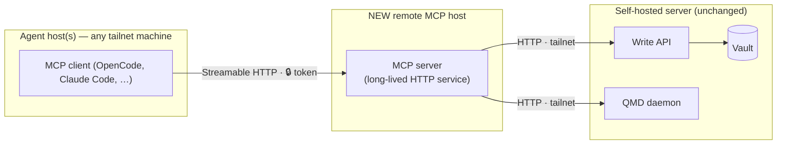
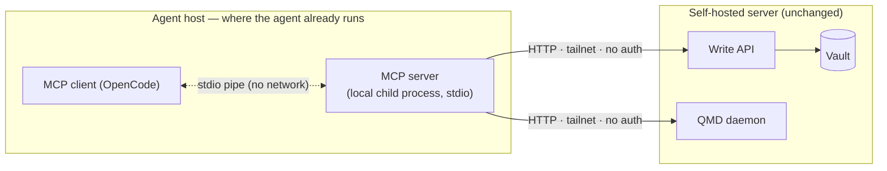
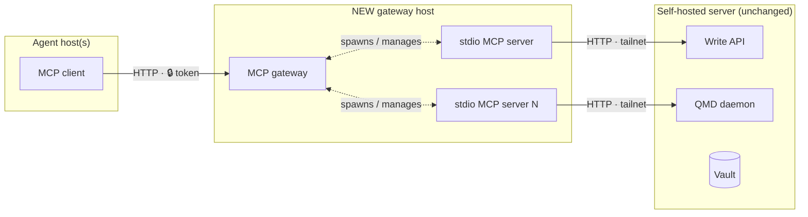

# Remote MCP Deployment — Investigation (#27)

Status: DECIDED — revised 2026-10-03 after review: topology 1 is the target
(phased). Phase 1 (#37) is implemented on `feat/mcp-streamable-http` — not
yet merged or deployed. See [Recommendation](#recommendation) and the
[Phase 1 runbook](#phase-1-runbook-streamable-http).
Date: 2026-10-03

## Context

The MCP server (`packages/mcp`) is stdio-only: `bin.ts` wires `createServer()`
into a `StdioServerTransport` and the process runs wherever the MCP client
runs. Tools reach the Write API and the QMD daemon over plain HTTP via
`globalThis.fetch`, using `AMS_API_URL` (required, no default) and
`AMS_QMD_URL` (defaults to `http://localhost:8181`). Configuration is resolved
lazily so the server starts even when an upstream is down; tools degrade
per-call.

Hard constraint (from #27): the vault, Write API and QMD daemon stay on the
current self-hosted server. A remote MCP deployment would reach those
upstreams over the tailnet.

### Verified current deployment

The primary client (OpenCode on the dev server) already runs the topology
labelled "topology 2" below:

```json
"ams": {
  "command": ["node", "/home/leandro/projects/AMS/packages/mcp/dist/bin.js"],
  "environment": {
    "AMS_API_URL": "http://100.64.20.67:3050",
    "AMS_QMD_URL": "http://100.64.20.67:8182"
  }
}
```

`100.64.x.x` is Tailscale's CGNAT range — both upstreams are reached over the
tailnet today, and the MCP process runs on the agent host. This is not a
hypothetical topology; it is the running baseline.

Architectural fact that shapes everything below: `createServer()` is
transport-agnostic (transport wiring lives entirely in the 15-line `bin.ts`),
and the MCP server holds no session state — every tool call is a stateless
HTTP round-trip to an upstream. Adding a second transport is additive, not
structural.

## Evidence

### SDK support (official TypeScript SDK)

- **Streamable HTTP** is the current standard network transport. The SDK ships
  `StreamableHTTPServerTransport` with two modes:
  - *Stateless*: `sessionIdGenerator: undefined` — each POST is handled
    independently, no session map, trivially horizontal. Fits AMS perfectly
    because tools are already stateless.
  - *Stateful*: `sessionIdGenerator: () => randomUUID()` — session map keyed
    by the `Mcp-Session-Id` header, idle eviction, GET stream for server
    notifications. AMS gains nothing from this today (no server-initiated
    messages, no subscriptions).
- **HTTP+SSE is deprecated** (remains as a client-side fallback only). Any new
  server-side work should target Streamable HTTP.
- **Auth**: the SDK's `requireBearerAuth` middleware gates a route behind a
  bearer token (401 `invalid_token` / 403 `insufficient_scope` with proper
  `WWW-Authenticate` challenges). Full OAuth 2.1 resource-server behaviour
  (RFC 9728 metadata routes, discovery) is available but only pays off with
  real authorization servers and multiple users.

> **Auth revision (2026-10-03, user-approved).** Phase 1 ships Hono's
> `bearer-auth` middleware, not the SDK's `requireBearerAuth`. Evidence
> (verified against installed sources): `requireBearerAuth` is Express-typed
> middleware (`RequestHandler` from `express`, which is not a workspace
> dependency) and rejects tokens that lack a numeric future `expiresAt` —
> designed for OAuth flows, awkward for a static token. Hono 4.12.27 was
> already in the dependency graph (`packages/api`); its `bearerAuth` compares
> timing-safely and emits proper `WWW-Authenticate` challenges, and the SDK's
> own docs show the Hono integration for the web-standard transport
> (`transport.handleRequest(c.req.raw)`). Phase 2 (#39) still plans the
> SDK's OAuth 2.1 resource-server machinery — only the phase 1 static-token
> mechanism is revised.

### Client support

- **OpenCode** (primary client): first-class remote MCP — `"type": "remote"`
  with `url`, custom `headers` (e.g. `Authorization: Bearer {env:TOKEN}`) and
  optional OAuth blocks. It constructs a StreamableHTTP client transport with
  an SSE legacy fallback automatically.
- **Claude Code / Codex / mainstream clients**: support streamable HTTP MCP
  endpoints (`claude mcp add --transport http`, `url`-based server entries).
  Support is broad but not literally universal; long-tail and older clients
  still assume stdio.
- **stdio**: supported by every MCP client without exception. It remains the
  compatibility baseline.

### Deployment surface

- The ghcr.io image (#18) already builds `packages/mcp` (Dockerfile compiles
  shared + api + mcp), so a remote host can pull one image and run either an
  upstream or an MCP process — the HTTP entrypoint
  (`packages/mcp/dist/http.js`, #37) now ships in the image, no Dockerfile
  change needed.

## Topologies evaluated

All three topologies are answers to one question: **where does the MCP
process run, and what stands between the agent and the vault?** The vault
box (Write API, QMD daemon, vault) is identical and never moves — only the
left side changes.

Legend: `─▶` network hop (needs the tailnet up) · `◁▷` local pipe/process
boundary (no network) · 🔒 point where a token/auth is required.

### Topology 1 — Network-facing MCP (Streamable HTTP) on a remote host

The MCP server becomes a long-lived HTTP service on the tailnet; agents
connect with a URL (+ token) instead of spawning a local process.



Two network legs per call (agent → MCP host, MCP host → upstreams). The MCP
process is shared by every agent, so it must authenticate callers and stay
up for everyone.

- **Pros**: one MCP deployment shared by all agent hosts; no Node/runtime
  requirement on agent hosts; client config shrinks to a URL; server-side
  observability (logs, health endpoint) in one place.
- **Cons**: requires auth on the MCP service itself (new secret, new
  rotation); session/lifecycle management even in stateless mode (health
  checks, restarts, idle behavior); adds a network hop between agent and
  upstreams (agent → MCP host → tailnet → API/QMD) which increases failure
  modes exactly where the issue worries about tailnet outages; every client
  must support HTTP transports (nearly true, not universally true).

### Topology 2 — stdio MCP on the agent host, upstreams over the tailnet (CURRENT)

The MCP process runs wherever the agent runs; `AMS_API_URL`/`AMS_QMD_URL`
point at tailnet addresses of the self-hosted server.



One network leg per call. The MCP process is not network-facing at all — it
is spawned by the agent and talks to its client over a local pipe — so the
tailnet is the only boundary and no token exists to leak or rotate.

- **Pros**: zero code changes (this is today's `bin.ts`); zero auth surface on
  the MCP side (the tailnet is the boundary — traffic never leaves the
  private network); one fewer network hop; stdio compatibility everywhere;
  per-agent isolation (one hung MCP process cannot affect other agents).
- **Cons**: every agent host needs the MCP artifact (checkout build or image
  pull) plus per-host env config; one process per agent session; upgrading the
  MCP means touching every agent host.

### Topology 3 — MCP gateway/proxy in front of stdio servers

A gateway accepts network MCP connections and fans out to N stdio server
processes.



Same two network legs as topology 1 plus a translation layer: the gateway
converts network MCP into local stdio processes. It exists to serve *many*
servers behind one endpoint — with exactly one server, it is a second
component to operate with nothing to fan out to.

- **Pros**: centralizes transport, auth and versioning for many servers;
  stdio servers stay untouched.
- **Cons**: a whole new component to operate for a fleet of exactly one
  server and one user; the gateway becomes a single point of failure that
  topology 2 does not have. Rejected as over-engineering at current scale.

## Comparison

| Dimension             | 1: Streamable HTTP | 2: stdio + tailnet (current) | 3: Gateway |
| --------------------- | ------------------ | ---------------------------- | ---------- |
| Code changes          | Add transport+auth | None                         | New service |
| Auth surface          | Token required     | Tailnet boundary only        | Token required |
| Network hops          | +1 (via MCP host)  | Direct                       | +1 |
| Client compatibility  | Broad, not total   | Universal                    | Broad, not total |
| Ops burden            | Service to run     | Artifact per agent host      | Service + fleet |
| Failure isolation     | Shared service     | Per agent process            | Shared gateway |

## Security model

For a single-user deployment, phased:

- **Phase 1 (tailnet-only service)**: tailnet reachability is the primary
  boundary; the static bearer token is defense in depth (a compromised
  tailnet peer or a misconfigured funnel must not get free write access to
  the memory vault). The MCP listens on the tailnet interface only.
- **Phase 2 (public exposure)**: the bar rises. The token alone is NOT an
  acceptable boundary between the public internet and vault writes — it must
  be OAuth 2.1 (the SDK's resource-server machinery with RFC 9728 metadata)
  or tunnel-fronted Cloudflare Access in front of the route, plus HTTPS via
  the existing cloudflared tunnel.
- Upstream traffic (MCP → API/QMD) stays plain HTTP *inside* the tailnet;
  WireGuard encryption covers the transport. No TLS work needed for upstream
  legs even in phase 2 — only the public MCP edge needs HTTPS.

## Operational concerns (apply to any remote variant)

- **Image**: remote host pulls from ghcr.io (#18); image already contains the
  compiled `packages/mcp`.
- **Config**: env-based as today (`AMS_API_URL`, `AMS_QMD_URL`); resolved
  lazily, so an unreachable upstream degrades per tool call — the server must
  keep starting and answer with tool-level errors, never crash at boot.
- **Failure modes**: tailnet link down → fetch timeouts per call; API down →
  write tools fail, read tools (QMD) may still work; QMD down → inverse.
  Health checks should probe the upstreams, not just the process.
- **Upgrades**: topology 2 upgrades are per-agent-host (pull + restart agent);
  topology 1 upgrades are one service restart shared by everyone.

## Recommendation

> **Revised after review.** The original recommendation kept stdio as the
> baseline. Two review considerations outweigh the minimal-surface argument:

### Why topology 1 wins on review

1. **Deployment centralization.** With stdio, every MCP change means pulling
   and deploying the artifact on every agent host (N hosts). With a
   network-facing MCP, one image update reaches every client on its next
   `initialize` — clients never need to be touched.
2. **Clients on hosts we do not control.** Mobile/web apps (Claude app
   custom connectors, ChatGPT connectors) speak remote MCP over HTTPS; they
   cannot spawn local stdio processes at all. Topology 2 makes these clients
   unreachable by construction; topology 1 unlocks them.

The trade is explicit: we accept one more network leg and a token to manage
in exchange for centralized deploys and client portability.

### Phased plan

**The MCP service does not need new hardware — it deploys on the existing
self-hosted server** (one more service in the compose stack, image from
ghcr.io). This is strictly better than a separate MCP host: MCP → upstream
calls become localhost/container-network round-trips (the tailnet-link
failure mode between MCP and upstreams disappears), and there is one box to
operate. The original "separate host" framing in #27 is satisfied by a
separate *service*, not a separate machine.

- **Phase 1 — tailnet service (#37)**: MCP as a long-lived HTTP service on
  the existing server, reachable at its tailnet address. Stateless Streamable
  HTTP behind a static bearer token (Hono `bearerAuth` — see the
  [auth revision](#sdk-support-official-typescript-sdk)), upstreams at
  localhost. Own agents (OpenCode on any tailnet host) switch from local
  stdio to the remote URL. Deployment becomes one image update; no public
  exposure. **Status: implemented on `feat/mcp-streamable-http` — see #37
  and the [Phase 1 runbook](#phase-1-runbook-streamable-http).**
- **Phase 2 — public reachability for external apps (#39)**: Claude app /
  ChatGPT clients run on vendor clouds and cannot reach a tailnet-only
  service. The existing cloudflared tunnel on the same server fronts the MCP
  with public HTTPS (origin at localhost) AND a real auth upgrade (OAuth 2.1
  resource server, or tunnel-fronted Cloudflare Access) — a static token
  alone is not an acceptable boundary between the public internet and write
  access to the vault.

Topology 2 remains the running baseline until phase 1 is merged and deployed
(phase 1 is implemented on `feat/mcp-streamable-http`; see #37). Topology 3
stays rejected (one server, one user — nothing to fan out).

### Decision summary

| Question     | Answer                                                  |
| ------------ | ------------------------------------------------------- |
| Transport    | Stateless Streamable HTTP (target); stdio stays as migration fallback |
| Auth         | Phase 1: static bearer token, tailnet-only. Phase 2: OAuth 2.1 / tunnel-fronted access for public |
| Network      | MCP runs on the existing self-hosted server: own agents reach it via tailnet (phase 1), external apps via cloudflared public HTTPS (phase 2). Upstreams stay localhost. Vault/API/QMD never move |

## Phase 1 runbook (Streamable HTTP)

Implemented on `feat/mcp-streamable-http` (see #37); not yet merged or
deployed. The stdio path is byte-for-byte unchanged and remains the
local/fallback transport.

### Quick path (local)

1. Generate a token (see the charset note below):

   ```bash
   openssl rand -base64 32
   ```

2. Build and start the service — both forms are equivalent:

   ```bash
   pnpm build

   # direct node invocation
   AMS_MCP_TOKEN="<token>" AMS_API_URL=http://localhost:3000 \
     node packages/mcp/dist/http.js

   # or via the package bin (linked by pnpm on install)
   AMS_MCP_TOKEN="<token>" AMS_API_URL=http://localhost:3000 pnpm exec ams-mcp-http
   ```

3. Verify:

   ```bash
   curl -s http://127.0.0.1:3111/health
   # {"status":"ok","upstreams":{"api":"up","qmd":"up"}}

   curl -i -X POST http://127.0.0.1:3111/mcp
   # HTTP/1.1 401 Unauthorized + WWW-Authenticate: Bearer realm=""
   ```

Point a remote-capable client at `http://<host>:3111/mcp` with an
`Authorization: Bearer <token>` header.

### Configuration

| Variable | Required | Default | Purpose |
| --- | --- | --- | --- |
| `AMS_MCP_TOKEN` | Yes (HTTP mode) | — | Static bearer token for `POST /mcp`. Startup fails fast when missing or empty; stdio mode ignores it. |
| `AMS_MCP_PORT` | No | `3111` | TCP port for the HTTP listener. Must be a non-negative number (validated at startup). |
| `AMS_MCP_HOST` | No | `127.0.0.1` | Bind address. Loopback by default; set `0.0.0.0` inside a container and let the port mapping control exposure. |
| `AMS_API_URL` | Yes | — | Write API base URL (no trailing slash). Used by the tools and the `/health` probe. |
| `AMS_QMD_URL` | No | `http://localhost:8181` | QMD base URL. Used by the tools and the `/health` probe. |

> **Token charset.** Hono's `bearer-auth` validates the token value in the
> `Authorization` header against `[A-Za-z0-9._~+/-]+=*` (verified in
> hono@4.12.27). A token containing any other character (embedded `=`, `:`,
> spaces, …) gets a `400` on every request. `openssl rand -base64 32`
> output qualifies.

### Endpoints

| Method & path | Auth | Behavior |
| --- | --- | --- |
| `POST /mcp` | Bearer token | MCP endpoint. Stateless: a fresh server + transport per request, JSON responses (`enableJsonResponse`), no sessions, no server-initiated SSE. |
| Other methods on `/mcp` | Bearer token | `405` with `Allow: POST` (a missing or bad token still yields `401` — auth runs before method routing). |
| `GET /health` | None | Upstream probe: `200` when both upstreams are `up`, `503` otherwise. Probes run in parallel with a 2s timeout each. |

Auth failures (Hono `bearerAuth`):

- missing `Authorization` header → `401`, `WWW-Authenticate: Bearer realm=""`
- valid charset, wrong value → `401`, `WWW-Authenticate: Bearer error="invalid_token"`
  (timing-safe comparison)
- malformed token (charset) → `400`, `WWW-Authenticate: Bearer error="invalid_request"`

`GET /health` response shapes:

```json
// 200 — both upstreams reachable
{ "status": "ok", "upstreams": { "api": "up", "qmd": "up" } }

// 503 — at least one upstream not up
{ "status": "degraded", "upstreams": { "api": "up", "qmd": "down" } }
```

Per-upstream values: `up` (probe returned 2xx), `down` (failure, non-2xx, or
timeout), `unconfigured` (empty base URL — counts as not ok). The endpoint
reports reachability only, never note content.

### Process behavior

- Logs to stderr only (`[ams-mcp-http] listening on ...`); stdout stays clean.
- `SIGTERM`/`SIGINT` → graceful close (idle keep-alive sockets drained) then
  exit 0 — `docker stop` terminates cleanly.
- Listener errors (e.g. `EADDRINUSE`) → fatal stderr line, exit 1.
- Missing `AMS_MCP_TOKEN` → startup fails fast: the entrypoint refuses to
  serve unauthenticated.
- Starts with upstreams down: configuration is lazy, tools degrade per call,
  `/health` reports `down`, the process stays up.

### Compose service (self-hosted stack)

The ghcr.io image already ships `packages/mcp/dist` and its production
dependencies, so no Dockerfile change is needed — the service only overrides
the command. Overriding `command` replaces the image's boot sequence, so this
container runs *only* the MCP service; the upstreams are the existing stack
services reached over the container network:

```yaml
services:
  ams-mcp:
    image: ghcr.io/leandrofernandez94/ams:latest
    command: node packages/mcp/dist/http.js
    environment:
      AMS_MCP_TOKEN: "${AMS_MCP_TOKEN:?set in .env}" # openssl rand -base64 32
      AMS_MCP_HOST: "0.0.0.0" # bind-all inside the container
      AMS_API_URL: "http://ams:3000" # existing Write API service (adjust name)
      AMS_QMD_URL: "http://ams:8181" # existing QMD daemon (adjust name)
    ports:
      - "100.64.20.67:3111:3111" # publish on the tailnet interface ONLY
    healthcheck:
      # the image's built-in HEALTHCHECK probes the Write API, not this
      # service — this service needs its own stanza
      test: ["CMD", "wget", "-q", "-T", "4", "-t", "1", "-O", "/dev/null", "http://localhost:3111/health"]
      interval: 30s
      timeout: 5s
      start_period: 20s
      retries: 3
    restart: unless-stopped
```

Notes:

- `wget` is available in the image (installed in the runtime stage) and
  treats the `503` degraded response as failure — an unreachable upstream
  marks the container unhealthy while the process keeps running. Treat
  unhealthy as "investigate upstreams", not "restart the service".
- The port mapping publishes on the host's tailnet address
  (`100.64.20.67` here — adjust to your host); nothing listens on the LAN or
  public interfaces.

> **Tailnet-only in phase 1.** The static token is defense in depth (see
> [Security model](#security-model)) — the tailnet is the boundary. Do NOT
> publish `AMS_MCP_PORT` on a public interface or through a public tunnel.
> Public exposure is phase 2 (#39) and requires OAuth 2.1 or tunnel-fronted
> access control.

## References

- `packages/mcp/src/bin.ts`, `config.ts`, `server.ts` — current architecture
- `packages/mcp/src/http.ts`, `http-app.ts` — phase 1 Streamable HTTP
  entrypoint and Hono app (see #37)
- Model Context Protocol TypeScript SDK docs — Streamable HTTP transport,
  session management, `requireBearerAuth` (retrieved 2026-10-03 via context7)
- OpenCode docs — remote MCP configuration (retrieved 2026-10-03 via context7)
