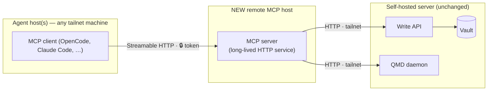
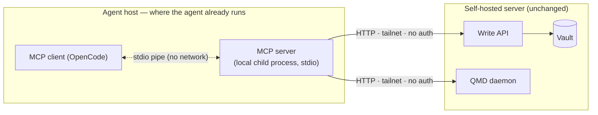
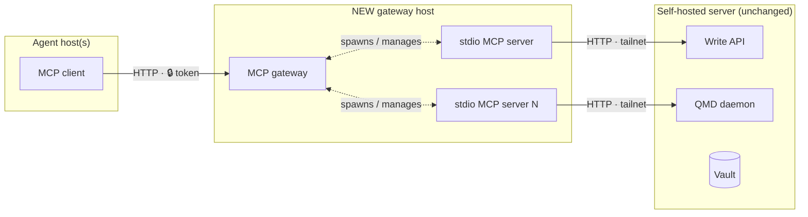

# Remote MCP Deployment — Investigation (#27)

Status: DECIDED — see [Recommendation](#recommendation).
Date: 2026-10-03

## Context

The MCP server (`packages/mcp`) is stdio-only: `bin.ts` wires `createServer()`
into a `StdioServerTransport` and the process runs wherever the MCP client
runs. Tools reach the Write API and the QMD daemon over plain HTTP via
`globalThis.fetch`, using `AMS_API_URL` (required, no default) and
`AMS_QMD_URL` (defaults to `http://localhost:8181`). Configuration is resolved
lazily so the server starts even when an upstream is down; tools degrade
per-call.

Hard constraint (from #27): the vault, Write API and QMD daemon stay on the
current self-hosted server. A remote MCP deployment would reach those
upstreams over the tailnet.

### Verified current deployment

The primary client (OpenCode on the dev server) already runs the topology
labelled "topology 2" below:

```json
"ams": {
  "command": ["node", "/path/to/ams/packages/mcp/dist/bin.js"],
  "environment": {
    "AMS_API_URL": "http://<tailnet-ip>:3050",
    "AMS_QMD_URL": "http://<tailnet-ip>:8182"
  }
}
```

`100.64.x.x` is Tailscale's CGNAT range — both upstreams are reached over the
tailnet today, and the MCP process runs on the agent host. This is not a
hypothetical topology; it is the running baseline.

Architectural fact that shapes everything below: `createServer()` is
transport-agnostic (transport wiring lives entirely in the 15-line `bin.ts`),
and the MCP server holds no session state — every tool call is a stateless
HTTP round-trip to an upstream. Adding a second transport is additive, not
structural.

## Evidence

### SDK support (official TypeScript SDK)

- **Streamable HTTP** is the current standard network transport. The SDK ships
  `StreamableHTTPServerTransport` with two modes:
  - *Stateless*: `sessionIdGenerator: undefined` — each POST is handled
    independently, no session map, trivially horizontal. Fits AMS perfectly
    because tools are already stateless.
  - *Stateful*: `sessionIdGenerator: () => randomUUID()` — session map keyed
    by the `Mcp-Session-Id` header, idle eviction, GET stream for server
    notifications. AMS gains nothing from this today (no server-initiated
    messages, no subscriptions).
- **HTTP+SSE is deprecated** (remains as a client-side fallback only). Any new
  server-side work should target Streamable HTTP.
- **Auth**: the SDK's `requireBearerAuth` middleware gates a route behind a
  bearer token (401 `invalid_token` / 403 `insufficient_scope` with proper
  `WWW-Authenticate` challenges). Full OAuth 2.1 resource-server behaviour
  (RFC 9728 metadata routes, discovery) is available but only pays off with
  real authorization servers and multiple users.

### Client support

- **OpenCode** (primary client): first-class remote MCP — `"type": "remote"`
  with `url`, custom `headers` (e.g. `Authorization: Bearer {env:TOKEN}`) and
  optional OAuth blocks. It constructs a StreamableHTTP client transport with
  an SSE legacy fallback automatically.
- **Claude Code / Codex / mainstream clients**: support streamable HTTP MCP
  endpoints (`claude mcp add --transport http`, `url`-based server entries).
  Support is broad but not literally universal; long-tail and older clients
  still assume stdio.
- **stdio**: supported by every MCP client without exception. It remains the
  compatibility baseline.

### Deployment surface

- The ghcr.io image (#18) already builds `packages/mcp` (Dockerfile compiles
  shared + api + mcp), so a remote host can pull one image and run either an
  upstream or (with a small entrypoint addition) an MCP process.

## Topologies evaluated

All three topologies are answers to one question: **where does the MCP
process run, and what stands between the agent and the vault?** The vault
box (Write API, QMD daemon, vault) is identical and never moves — only the
left side changes.

Legend: `─▶` network hop (needs the tailnet up) · `◁▷` local pipe/process
boundary (no network) · 🔒 point where a token/auth is required.

### Topology 1 — Network-facing MCP (Streamable HTTP) on a remote host

The MCP server becomes a long-lived HTTP service on the tailnet; agents
connect with a URL (+ token) instead of spawning a local process.



Two network legs per call (agent → MCP host, MCP host → upstreams). The MCP
process is shared by every agent, so it must authenticate callers and stay
up for everyone.

- **Pros**: one MCP deployment shared by all agent hosts; no Node/runtime
  requirement on agent hosts; client config shrinks to a URL; server-side
  observability (logs, health endpoint) in one place.
- **Cons**: requires auth on the MCP service itself (new secret, new
  rotation); session/lifecycle management even in stateless mode (health
  checks, restarts, idle behavior); adds a network hop between agent and
  upstreams (agent → MCP host → tailnet → API/QMD) which increases failure
  modes exactly where the issue worries about tailnet outages; every client
  must support HTTP transports (nearly true, not universally true).

### Topology 2 — stdio MCP on the agent host, upstreams over the tailnet (CURRENT)

The MCP process runs wherever the agent runs; `AMS_API_URL`/`AMS_QMD_URL`
point at tailnet addresses of the self-hosted server.



One network leg per call. The MCP process is not network-facing at all — it
is spawned by the agent and talks to its client over a local pipe — so the
tailnet is the only boundary and no token exists to leak or rotate.

- **Pros**: zero code changes (this is today's `bin.ts`); zero auth surface on
  the MCP side (the tailnet is the boundary — traffic never leaves the
  private network); one fewer network hop; stdio compatibility everywhere;
  per-agent isolation (one hung MCP process cannot affect other agents).
- **Cons**: every agent host needs the MCP artifact (checkout build or image
  pull) plus per-host env config; one process per agent session; upgrading the
  MCP means touching every agent host.

### Topology 3 — MCP gateway/proxy in front of stdio servers

A gateway accepts network MCP connections and fans out to N stdio server
processes.



Same two network legs as topology 1 plus a translation layer: the gateway
converts network MCP into local stdio processes. It exists to serve *many*
servers behind one endpoint — with exactly one server, it is a second
component to operate with nothing to fan out to.

- **Pros**: centralizes transport, auth and versioning for many servers;
  stdio servers stay untouched.
- **Cons**: a whole new component to operate for a fleet of exactly one
  server and one user; the gateway becomes a single point of failure that
  topology 2 does not have. Rejected as over-engineering at current scale.

## Comparison

| Dimension             | 1: Streamable HTTP | 2: stdio + tailnet (current) | 3: Gateway |
| --------------------- | ------------------ | ---------------------------- | ---------- |
| Code changes          | Add transport+auth | None                         | New service |
| Auth surface          | Token required     | Tailnet boundary only        | Token required |
| Network hops          | +1 (via MCP host)  | Direct                       | +1 |
| Client compatibility  | Broad, not total   | Universal                    | Broad, not total |
| Ops burden            | Service to run     | Artifact per agent host      | Service + fleet |
| Failure isolation     | Shared service     | Per agent process            | Shared gateway |

## Security model

For a single-user, tailnet-only deployment:

- **Tailnet reachability is the primary boundary.** No public exposure, no
  ingress, no DNS that resolves outside the tailnet. This is acceptable as
  the *only* boundary for topology 2 because the MCP process is not
  network-listening at all.
- **A network transport must add a token regardless of tailnet trust** (defense
  in depth: a compromised tailnet peer, a misconfigured `serve`/funnel, or a
  laptop joining the tailnet should not get write access to the memory vault
  for free). Minimum viable: a static bearer token verified by
  `requireBearerAuth`, delivered via env, no scoping. OAuth 2.1 machinery is
  explicitly deferred — it solves multi-user/multi-tenant problems AMS does
  not have.
- Upstream traffic (MCP → API/QMD) stays plain HTTP *inside* the tailnet;
  WireGuard encryption covers the transport. No TLS work needed until
  something leaves the tailnet.

## Operational concerns (apply to any remote variant)

- **Image**: remote host pulls from ghcr.io (#18); image already contains the
  compiled `packages/mcp`.
- **Config**: env-based as today (`AMS_API_URL`, `AMS_QMD_URL`); resolved
  lazily, so an unreachable upstream degrades per tool call — the server must
  keep starting and answer with tool-level errors, never crash at boot.
- **Failure modes**: tailnet link down → fetch timeouts per call; API down →
  write tools fail, read tools (QMD) may still work; QMD down → inverse.
  Health checks should probe the upstreams, not just the process.
- **Upgrades**: topology 2 upgrades are per-agent-host (pull + restart agent);
  topology 1 upgrades are one service restart shared by everyone.

## Recommendation

1. **Baseline stays topology 2 (stdio where agents live, upstreams over the
   tailnet).** It is the already-running architecture, needs zero code,
   carries zero auth surface, has universal client compatibility and the
   fewest failure modes. The vault and its upstreams never move.
2. **Add an optional Streamable HTTP transport to `packages/mcp` as a
   follow-up** (#37): a second entrypoint (or env-selected mode in `bin.ts`)
   using `StreamableHTTPServerTransport` in **stateless** mode behind
   `requireBearerAuth` with a static token, exposed tailnet-only. This keeps
   the package ready for agent hosts that cannot run local processes, at
   ~100 lines, without disturbing the stdio path.
3. **Defer**: OAuth 2.1 flows, gateway/proxy topologies, and any public
   internet exposure. None maps to a current single-user tailnet reality.

### Decision summary

| Question                    | Answer                                        |
| --------------------------- | --------------------------------------------- |
| Transport                   | stdio baseline; optional stateless Streamable HTTP behind a token (#37) |
| Auth                        | Tailnet boundary for stdio; + static bearer token for HTTP |
| Network model               | All traffic tailnet-only; vault/API/QMD never move |

## References

- `packages/mcp/src/bin.ts`, `config.ts`, `server.ts` — current architecture
- Model Context Protocol TypeScript SDK docs — Streamable HTTP transport,
  session management, `requireBearerAuth` (retrieved 2026-10-03 via context7)
- OpenCode docs — remote MCP configuration (retrieved 2026-10-03 via context7)
